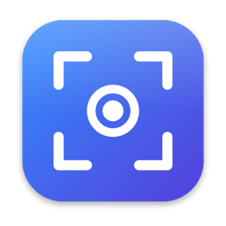
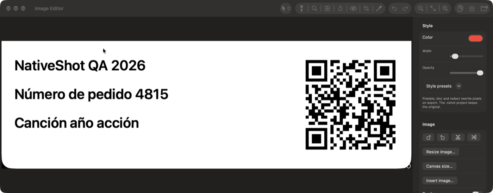
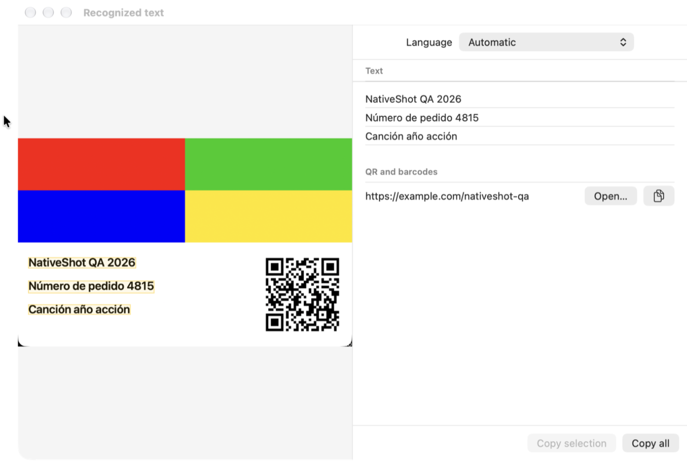
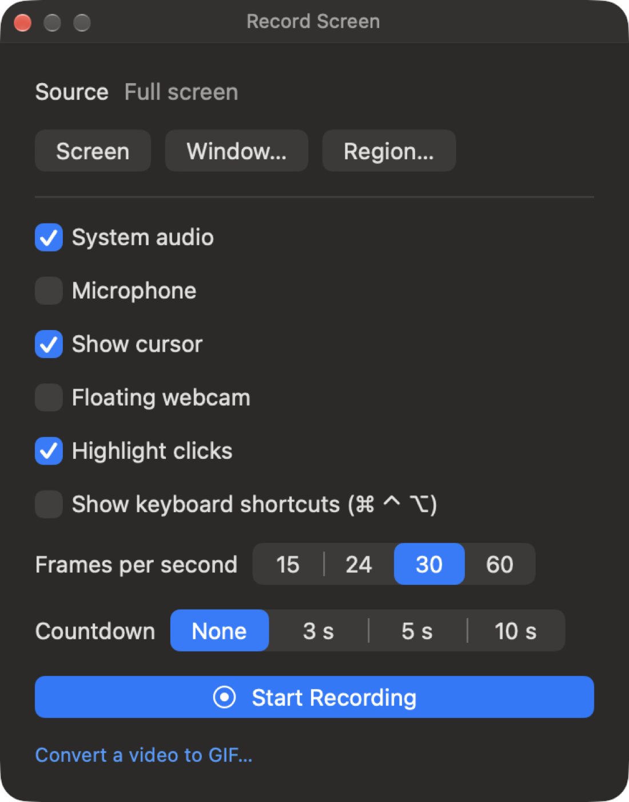
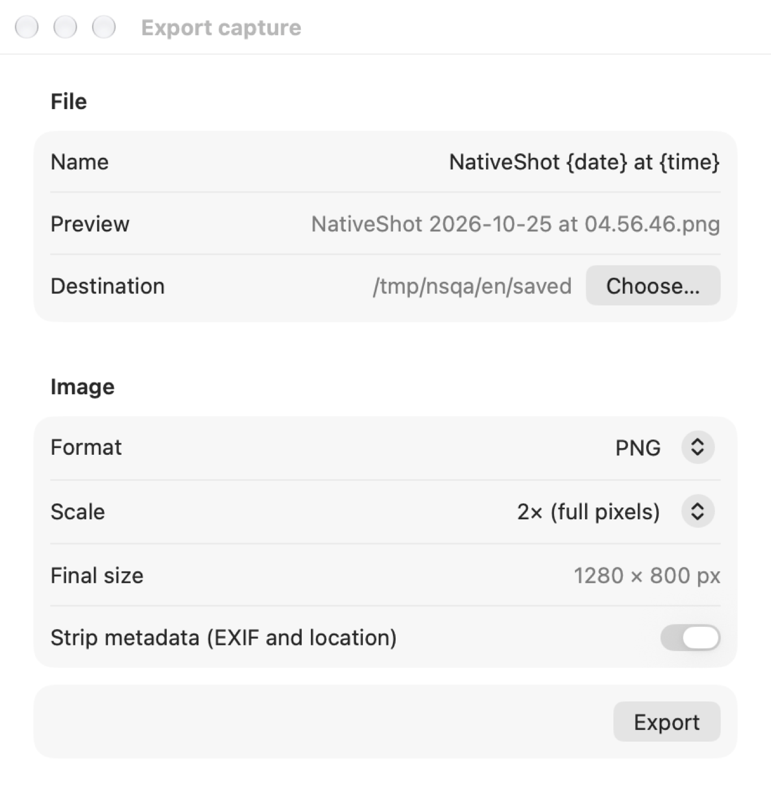
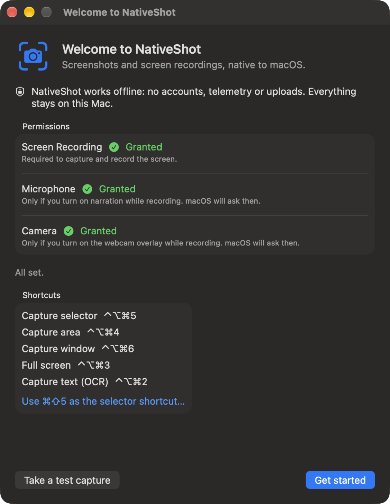

<p align="center">
  
</p>

<h1 align="center">NativeShot</h1>

<p align="center">
  <strong>Capturas e gravações de tela, nativas do macOS.</strong><br>
  Gratuito, de código aberto e offline. Sem contas, sem telemetria e sem uploads.
</p>

<p align="center">
  <a href="https://github.com/PabloJuGo/NativeShot/releases/latest"></a>
  
  
  <a href="LICENSE"></a>
</p>

<p align="center">
  <a href="README.md">English</a> · <a href="README.es.md">Español</a> · <a href="README.fr.md">Français</a> · <a href="README.de.md">Deutsch</a> · <b>Português</b>
</p>

---

O NativeShot fica na barra de menus e substitui a ferramenta de captura do sistema por algo mais rápido e completo. Capture qualquer área, janela ou tela, faça anotações, extraia o texto, fixe a captura sobre o seu trabalho ou grave a tela com som e webcam. Tudo acontece no seu Mac.

<p align="center">
  
</p>

## Recursos

**Captura**
- Área, janela (com ou sem sombra), tela inteira e **captura com rolagem** (vertical, horizontal ou direto para PDF).
- Lupa com coordenadas, tela congelada, proporções e tamanhos fixos, e ajuste da seleção antes de capturar.
- **Várias regiões** de uma vez: segure ⌘ ao arrastar e pressione Return para terminar.
- Repetir a última área ou a última captura, temporizador e cursor opcional.
- Pode assumir o `⌘⇧5` com um assistente guiado, que nunca altera os ajustes do sistema por você.

**Depois da captura**
- Miniatura flutuante para copiar, salvar, editar, fixar, compartilhar, arrastar, apagar, imprimir e mais. Tudo funciona pelo teclado.
- **Fixe** qualquer captura sobre todas as janelas, com zoom, opacidade e um bloqueio que deixa os cliques passarem.
- **Reconhecimento de texto (OCR)** e leitura de QR codes e códigos de barras no próprio Mac. Os links são mostrados e nunca abertos sem perguntar.
- **Gerenciador de exportação**: modelo de nome, pasta, PNG, JPEG, HEIC, TIFF ou PDF, qualidade, escala e remoção de metadados.

**Editor de imagens**
- Setas, linhas, formas, texto, marca-texto, contadores numerados, destaque, lupa, imagens inseridas e camadas.
- **Ocultação irreversível** (bloco, pixelização, desfoque): ao exportar, os pixels são reescritos, não apenas cobertos.
- Fundos e molduras para capturas apresentáveis, e projetos `.nshot` editáveis.

**Gravação de tela**
- Tela, janela ou área; áudio do sistema e microfone; webcam flutuante; cliques e teclas destacados; contagem regressiva e pausa.
- MP4 ou MOV, em H.264 ou HEVC, e exportação para GIF.
- Editor de vídeo: aparar, cortar, zoom automático nos cliques, acompanhamento do cursor, trechos sem som e legendas.

**Biblioteca**
- Histórico local com busca, inclusive pelo texto dentro das capturas. Favoritos, etiquetas, lixeira e regras de retenção.
- **Sessão privada**: enquanto estiver ativa, nada é guardado.

<table>
  <tr>
    <td></td>
    <td></td>
  </tr>
  <tr>
    <td></td>
    <td></td>
  </tr>
</table>

## Instalação

1. Baixe o **`NativeShot-1.0.0.dmg`** da [versão mais recente](https://github.com/PabloJuGo/NativeShot/releases/latest).
2. Abra o arquivo e arraste o **NativeShot** para **Aplicativos**.
3. Abra o NativeShot. Na primeira vez, o macOS dirá que não consegue verificar o desenvolvedor, porque o app é gratuito e não foi notarizado pela Apple. Para abrir mesmo assim:
   - vá em **Ajustes do Sistema › Privacidade e Segurança**, role até a mensagem sobre o NativeShot, clique em **Abrir Mesmo Assim** e confirme;
   - ou, no Terminal: `xattr -dr com.apple.quarantine /Applications/NativeShot.app`
4. Conceda **Gravação de Tela** quando o macOS pedir (Ajustes do Sistema › Privacidade e Segurança › Gravação de Tela e Áudio do Sistema). O microfone e a câmera só são pedidos se você os ativar numa gravação.

Requisitos: macOS 15 Sequoia ou posterior, com Apple silicon ou Intel. A interface está disponível em inglês e espanhol.

Para verificar o download, use o arquivo `SHA256SUMS` que acompanha cada versão: `shasum -a 256 -c SHA256SUMS`.

## Atalhos padrão

| Ação | Atalho |
|---|---|
| Seletor de captura | `⌃⌥⌘5` (ou `⌘⇧5` em Settings › Shortcuts) |
| Área | `⌃⌥⌘4` |
| Janela | `⌃⌥⌘6` |
| Tela inteira | `⌃⌥⌘3` |
| Texto (OCR) | `⌃⌥⌘2` |

Durante a seleção: `Espaço` alterna entre área e janela, arrastar com `⌘` adiciona uma região, as setas ajustam a seleção, `Return` confirma e `Esc` cancela. Todos os atalhos podem ser alterados nos Ajustes.

## Privacidade

O NativeShot não se conecta à internet. Não há conta, análise de uso, relatórios de falhas nem nuvem. As capturas, o texto reconhecido e o áudio nunca saem do seu Mac. A única requisição de rede possível é a verificação de atualizações, e só quando você clica em **Check for updates…**. A sua biblioteca fica em `~/Library/Application Support/NativeShot/`. Mais detalhes em [PRIVACY.md](PRIVACY.md).

## Compilar a partir do código

Só são necessárias as Command Line Tools do Xcode (Swift 6.2), não o Xcode.

```sh
git clone https://github.com/PabloJuGo/NativeShot.git
cd NativeShot
scripts/test.sh             # executa os testes
scripts/bundle.sh           # gera build/NativeShot.app
open build/NativeShot.app
```

O `scripts/package.sh` gera o DMG e o ZIP. A assinatura ad hoc muda a cada compilação, então o macOS pode pedir de novo a permissão de Gravação de Tela depois de recompilar. Para evitar isso, assine com a sua própria identidade: `SIGN_IDENTITY="Meu certificado" scripts/bundle.sh`.

## Contribuir

Relatos de bugs, traduções e pull requests são bem-vindos. Leia antes o [CONTRIBUTING.md](CONTRIBUTING.md). Problemas de segurança devem ser comunicados pelo [SECURITY.md](SECURITY.md), não em issues públicas. As notas de cada versão estão no [CHANGELOG.md](CHANGELOG.md).

## Licença

O NativeShot é software livre sob a [Licença Pública Geral GNU v3.0](LICENSE). Você pode usá-lo, estudá-lo, modificá-lo e compartilhá-lo. Se distribuir uma versão modificada, ela deve continuar sob a GPL-3.0, com o código-fonte disponível.
